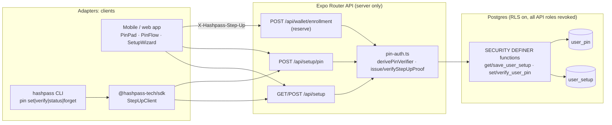
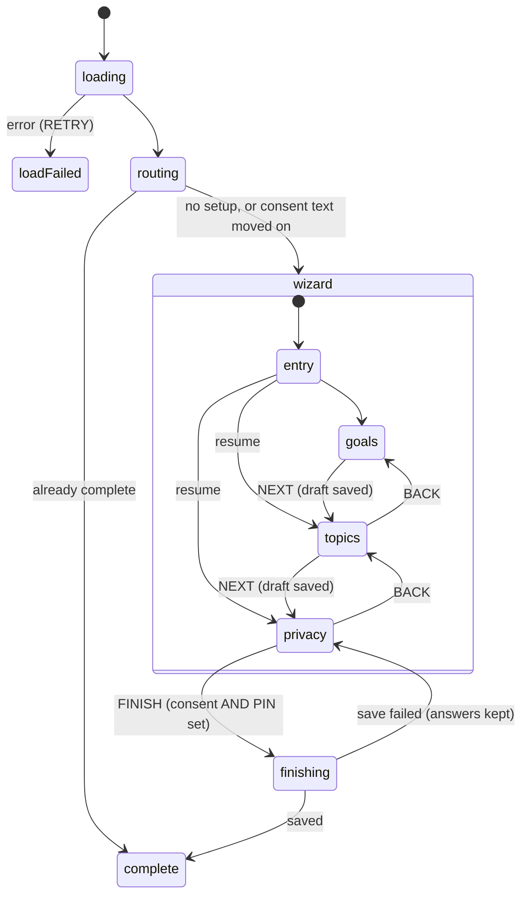
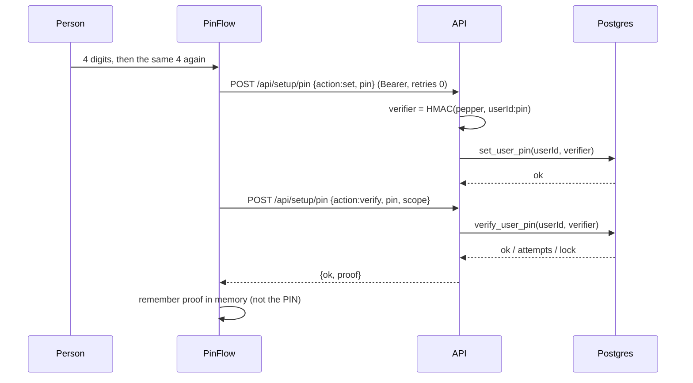

# Second factor: per-user PIN, setup and step-up proofs

Status: implemented; the app-side gate and onboarding wizard ship in v1.9.142. Server
enforcement is live in code for wallet creation; it fails closed (HTTP 503) until
`HASHPASS_PIN_PEPPER` is provisioned in the API environments.

The app-side wallet flows (the PIN gate, the create-only vault wizard, the PIN-change
unknown-outcome rule and the locked-gate recovery entry) are documented in
[wallet-onboarding.md](../reference/mobile-app/wallet-onboarding.md).

This document covers what a signed-in person does *in addition to* signing in: choose a
4-digit PIN once, and re-enter it before something sensitive happens (creating a wallet today,
signing transactions next). It is not a login method and never replaces one.

## 1. Goals and non-goals

| Goal | How it is met |
|------|---------------|
| One PIN per account, shared by app, wallet and CLI | `public.user_pin`, keyed by the canonical registry user id |
| A first-run setup for Contacts, in three steps | `public.user_setup` + the setup wizard state machine |
| Sensitive actions need a *fresh* second factor | Short-lived, scope-bound step-up proofs checked on the server |
| Modular: a time-based device locker can be added later | `SecondFactorMethod` seam in the SDK; proofs and scopes do not change |
| Usable from the SDK and `hashpass` CLI | `StepUpClient`, `hashpass pin status|set|verify|forget` |

Non-goals: the PIN does not sign you in, does not unlock the device wallet's own password
(the wallet keeps a separate password and recovery phrase), and is not a recovery mechanism.
Nobody at HASHPASS can reset or read it.

## 2. Architecture (hexagonal)

The domain rules (lockout, scopes, proof lifetime) sit in the middle. Every adapter talks to
them through the same HTTP contract, so a new client or a new factor adds an adapter without
touching the rules.



Key rule: **the browser/app never talks to these tables.** RLS is enabled, every privilege is
revoked from `PUBLIC`, `anon`, `authenticated` and `service_role`, and only four functions are
executable, only by `service_role`, with `SET search_path = ''`. The API resolves the caller
(`resolveNotificationIdentity` → `registryUserId`) and passes it as `p_user_id`, so a client
can never name another user.

## 3. Data model

`public.user_setup` (one row per user)

| Column | Notes |
|--------|-------|
| `status` | `not_started` · `in_progress` · `complete` |
| `step` | 0–3, where the person resumes |
| `goals` | ≤ 3 of `hire, get_hired, cofounders, learn, investors, friends` (CHECK-enforced) |
| `topics` | ≤ 5 of the Contacts topics (CHECK-enforced) |
| `privacy_scope` | `private` (default) or `public`; nothing is shared until chosen |
| `consent_version`, `consented_at` | Bump `CURRENT_CONSENT_VERSION` in `lib/setup.ts` when the consent copy changes materially; everyone below it is asked again |
| `completed_at` | `complete` requires completion, consent version and time (CHECK) |

`public.user_pin` (one row per user)

| Column | Notes |
|--------|-------|
| `verifier bytea(32)` | HMAC output only. Never the PIN. |
| `kdf_version` | Lets the derivation be upgraded later without a flag day |
| `failed_attempts`, `locked_until` | Lockout state, updated under a row lock |
| `set_at`, `last_verified_at` | Audit hints; no PIN-derived data |

## 4. Why a 4-digit PIN is acceptable here

A 4-digit PIN has 10,000 values. **No hash makes that safe offline**, so the design never
relies on hashing strength. Two independent barriers do the work, and neither may be removed
on the assumption that the other is enough:

1. **Server pepper.** The verifier is `HMAC-SHA256(pepper, "hashpass-pin:v1:{userId}:{pin}")`.
   The pepper (`HASHPASS_PIN_PEPPER`, ≥ 32 characters) exists only in the API environment.
   A database leak alone yields 32-byte values that cannot be tested without it; binding the
   user id means identical PINs never share a verifier.
2. **Atomic lockout.** `verify_user_pin()` runs under `FOR UPDATE`, so concurrent guesses are
   serialised and counted exactly once.

Lockout schedule: 5 wrong guesses are free of delay; the 5th triggers a lock of
`30 s × 2^(n−5)` (n = total consecutive failures), capped at 1 hour, until a correct PIN
resets the counter. Worst case an attacker holding a stolen session gets about 5 guesses,
then ≤ 1 per hour: roughly 120 guesses/day against a space of 10,000.

Consequences that are deliberate:

- A wrong PIN returns **HTTP 200** with `ok:false`, so the counter commits and the client can
  show "N tries left". The client never retries a PIN call automatically (`retries: 0`):
  every request is a guess.
- The pad rejects malformed input locally, so a typo in format never costs an attempt.
- Changing the PIN requires the current one, and a wrong current PIN is a guess too.
- If the pepper is missing or short the API answers 503 `pin_unavailable`. It never falls
  back to an unpeppered verifier.
- Rotating the pepper invalidates every PIN (people must set a new one) and every live proof.
  Treat that as an incident procedure, not routine maintenance.

## 5. Step-up proofs

A correct PIN yields a **proof**, not a session: an HMAC-signed token

```
base64url(claims) . base64url(HMAC-SHA256(proofKey, base64url(claims)))
claims = { v:1, sub:<userId>, scope, iat, exp, jti }
```

| Scope | Lifetime | Used for |
|-------|---------:|----------|
| `app:unlock` | 300 s | Screen lock / re-entering Contacts, PIN setup confirmation |
| `wallet:unlock` | 300 s | Opening the wallet screen (the PIN gate); creating the vault envelope (expectedVersion 0) |
| `wallet:sign` | 60 s | Creating a wallet (reservation); signing transactions next |
| `wallet:recover` | 600 s | PIN recovery only — minted solely by the recovery verify route (§12), never by verify-PIN |

Properties, all covered by tests (`tests/lib/pin-auth.test.ts`):

- Bound to the user (`sub`) and to **one scope**; a proof for `app:unlock` is refused for
  `wallet:sign`.
- Signed with a key derived from the pepper under a different label (`hashpass-step-up:v1`),
  so a stored verifier can never be replayed as a proof or the reverse.
- Verified in constant time; length-bounded (≤ 512 bytes); exactly three dot-separated parts
  are rejected as malformed; expired proofs are refused.
- Sent only in the `X-Hashpass-Step-Up` header to endpoints that require it.
- Never persisted by the app: `lib/step-up-session.ts` keeps proofs in memory, drops them on
  expiry (an unref'd timer notifies subscribers), when the account changes and on sign-out
  (`useAuth.signOut` calls `forgetProofs()`).

### Enforcement today

`POST /api/wallet/enrollment` with `action: "reserve"` (the moment a wallet is created)
requires a valid `wallet:sign` proof for the authenticated owner; otherwise `403
step_up_required`. The client maps that to `wallet_step_up_required`, forgets the proof and
asks again. Reading metadata and `register` do not need a proof (registration follows a
reservation that already did). Transaction signing is not shipped yet; it will require the
same proof per signing request.

## 6. Flows

### 6.1 First Contacts open: three-step setup



1. **Goals** (≤ 3), 2. **Topics** (≤ 5), 3. **Privacy**: scope, consent switch, and PIN creation.
The wizard cannot finish without both consent and a PIN. Drafts are saved best-effort per step
and queued, so the final save always lands after them. The machine never receives the PIN; the
pad reports only `PIN_SET`. `ContactsScreen` shows the wizard instead of Contacts until the
phase is `complete`; guests are never gated and trigger no request.

### 6.2 Create a PIN (inside the wizard, or on first wallet creation)



### 6.3 Create a wallet (second factor in front of reservation)

```mermaid
sequenceDiagram
  participant P as Person
  participant G as WalletGate
  participant W as WalletVaultFlow
  participant A as API
  P->>G: open the wallet tab
  alt no live wallet:unlock proof
    G->>P: PinFlow (unlock intent, scope wallet:unlock)
    P->>G: PIN → proof
  end
  G->>W: unlock; wizard shows the card
  P->>W: Create wallet
  W->>P: enter the PIN digits (they encrypt the vault; asked again by design)
  P->>W: PIN → unlock proof used for the envelope
  W->>A: reserve + X-Hashpass-Step-Up: wallet:sign proof
  A->>A: verifyStepUpProof(owner, wallet:sign)
  alt valid
    A-->>W: reserved
  else missing / expired / wrong scope / other user
    A-->>W: 403 step_up_required
    W-->>P: forget proof, ask again
  end
```

The PIN appears twice at creation on purpose: the gate verifies *identity* (it exchanges
the PIN for a `wallet:unlock` proof), while the wizard needs the *digits themselves* to
wrap the vault envelope — the PIN is never stored, so it must be asked whenever something
is encrypted with it. Full app-side flow:
[wallet-onboarding.md](../reference/mobile-app/wallet-onboarding.md).

Resuming an existing local wallet does not need the PIN; the wallet password protects it.

## 7. API contract

All setup routes reply `{ success, data }`; the client unwraps both levels. Write endpoints
require `Authorization: Bearer` (cookies are ignored, closing CSRF), accept JSON ≤ 4096
bytes with a strict key allowlist, and return generic errors.

| Route | Purpose |
|-------|---------|
| `GET /api/setup` | Setup state and `pin: { enabled, lockedUntil, remainingAttempts }` |
| `POST /api/setup` | Save a draft or completion (`goals`, `topics`, `privacyScope`, `consentVersion`, `step`, `complete`) |
| `POST /api/setup/pin` `{action:"set", pin, currentPin?}` | Create or change the PIN |
| `POST /api/setup/pin` `{action:"verify", pin, scope}` | Check the PIN, return `{ok, remainingAttempts, lockedUntil, proof?}` |

Global endpoints are called with `skipEventSegment: true, retries: 0`.

## 8. SDK and CLI

```ts
const hashpass = createHashpass({ /* options, optional stepUpStore */ });
await hashpass.stepUp.setPin('1234');                               // create
const result = await hashpass.stepUp.verify('1234', 'wallet:sign'); // result.ok → proof stored
const proof = await hashpass.stepUp.getProof('wallet:sign');        // null once lapsed
// or: ask for a proof only when none is live
const live = await hashpass.stepUp.require('wallet:sign', () => promptForPin());
```

- Proof storage is pluggable (`StepUpProofStore`); the default is in-memory.
- The SDK transport never retries a POST without an idempotency key, so a PIN guess is
  never repeated silently.
- CLI: `hashpass pin status | set | verify [--scope …] | forget [--scope …]`. The PIN is
  **never** a flag or environment variable: it is read from a hidden TTY prompt or from piped
  stdin. Proofs live in `<session file>.step-up`, mode 0600, and are low-value (60 s / 300 s,
  one scope each).

## 9. Adding the time-based device locker (extension seam)

Implement `SecondFactorMethod` and register it:

```ts
class DeviceLocker implements SecondFactorMethod<{ assertion: string }> {
  readonly id = 'device-locker';
  async verify(credential, scope) { /* call a new server route; return StepUpResult */ }
}
hashpass.stepUp.registerMethod(new DeviceLocker(/* transport, store, as PinMethod does */));
await hashpass.stepUp.verify({ assertion }, 'wallet:sign', 'device-locker');
```

What stays the same: proof format, scopes, TTLs and every endpoint that calls
`verifyStepUpProof`. What is new: a server route that validates the locker's own evidence
(time window, device binding) and then calls `issueStepUpProof`. Because sensitive endpoints
only check the proof, they need no change. Decide before building whether the locker *adds to*
or *replaces* the PIN for a scope; add that policy in one place on the server rather than in
each endpoint.

## 10. Operations

- **Provisioning**: set `HASHPASS_PIN_PEPPER` (≥ 32 random characters) in the dev and prod API
  Lambdas through `packages/tools/scripts/deploy-api-lambda.sh`, which masks values. Never
  print it, commit it, or pass it through `aws lambda update-function-configuration` output.
  Use different values per environment. Without it, PIN endpoints and wallet creation return
  503 / refuse (fail closed).
- **Migration**: `db/migrations/V128__user_setup_and_pin.sql`. Dev first, then prod, per the
  migration practice in `docs/agent-history.md`.
- **Tests**: `bash db/tests/run-user-setup-pin.sh` (throwaway Postgres on a unix socket:
  access boundary, validation, lockout, concurrency); it runs in the `codecov.yml` workflow.
  App: `npx jest tests/lib/pin-auth tests/api/setup-pin tests/hooks tests/components/security
  tests/wallet`. SDK/CLI: `pnpm --filter @hashpass-tech/sdk test`, `… sdk-cli test`.
- **Logging**: never log request bodies for `/api/setup/pin`. The code logs neither PIN, verifier
  nor proof.

## 11. Threat model summary

| Threat | Mitigation |
|--------|------------|
| Database leak | Verifiers are peppered HMACs; pepper not in the DB; RLS + revoked grants |
| Pepper leak alone | Useless without verifiers; rotate pepper (invalidates all PINs) |
| Both leak | 10,000 values are brute-forceable offline. Accepted residual risk; this is why the PIN is a *second* factor on top of an authenticated session, and why wallet keys stay protected by a separate password |
| Online guessing with a stolen session | 5 free guesses, then exponential lock capped at 1 h; atomic under row lock |
| Parallel guessing | `FOR UPDATE` serialises; client allows one request in flight |
| Replay of a captured proof | 60 s / 300 s lifetime, user- and scope-bound; not a session |
| Cross-user use | `sub` bound; `p_user_id` set server-side only |
| CSRF | Bearer required on writes, cookies stripped |
| Stolen unlocked phone | Proofs in memory only; cleared on sign-out, account change, expiry |
| Shoulder-surfing | Dots only, no echo; reduced to hardware-key support on web for accessibility |
| Account switch race | Late answers dropped by generation checks in `useSetup`, `usePin`, proof store |

## 12. Wallet PIN recovery (email code + recovery phrase)

If someone forgets their PIN, the account session alone is **not** enough to replace it —
that would make the second factor pointless. Recovery requires control of the registered
email, and replacing the wallet vault additionally requires the recovery phrase.

Flow (dev/testnet only, same gate as wallet setup):

1. `POST /api/wallet/pin-recovery {action:'send'}` — authenticated session + bearer; emails
   a single-use six-digit code (`otp_codes` purpose `wallet-pin-reset`, V138: HMAC-only
   storage, 10-minute expiry, five attempts, atomic `consume_email_otp`, 60 s resend
   cooldown). Never logged.
2. `{action:'verify', code}` — consumes the code atomically and returns a **`wallet:recover`
   proof** (TTL 600 s). This is the only endpoint that can mint that scope: the verify-PIN
   route rejects it (`PIN_MINTABLE_SCOPES` is a separate, smaller allow-list than
   `STEP_UP_SCOPES`), so a lost PIN can never be used to bootstrap its own replacement.
3. The client then uses the recovery phrase to re-wrap its wallet vault locally and saves
   the new envelope via `POST /api/wallet/vault` with `expectedVersion > 0` — the vault
   route accepts `wallet:recover` for reads and replacements (not creation).
4. `{action:'set-pin', newPin}` with the same proof header calls service-role-only
   `reset_user_pin`, which overwrites the verifier and clears attempts/lockout.

Ordering rule: **vault first, PIN second.** The old PIN keeps working until the very last
step, both steps fit inside the 600 s proof, and a failure between them can be retried with
the same proof — no half-reset state exists. The server never re-wraps the vault on its own
(it cannot: the seed is under client-held keys), and a lost recovery phrase plus a lost PIN
together means the wallet is unrecoverable through HASHPASS, by design.
