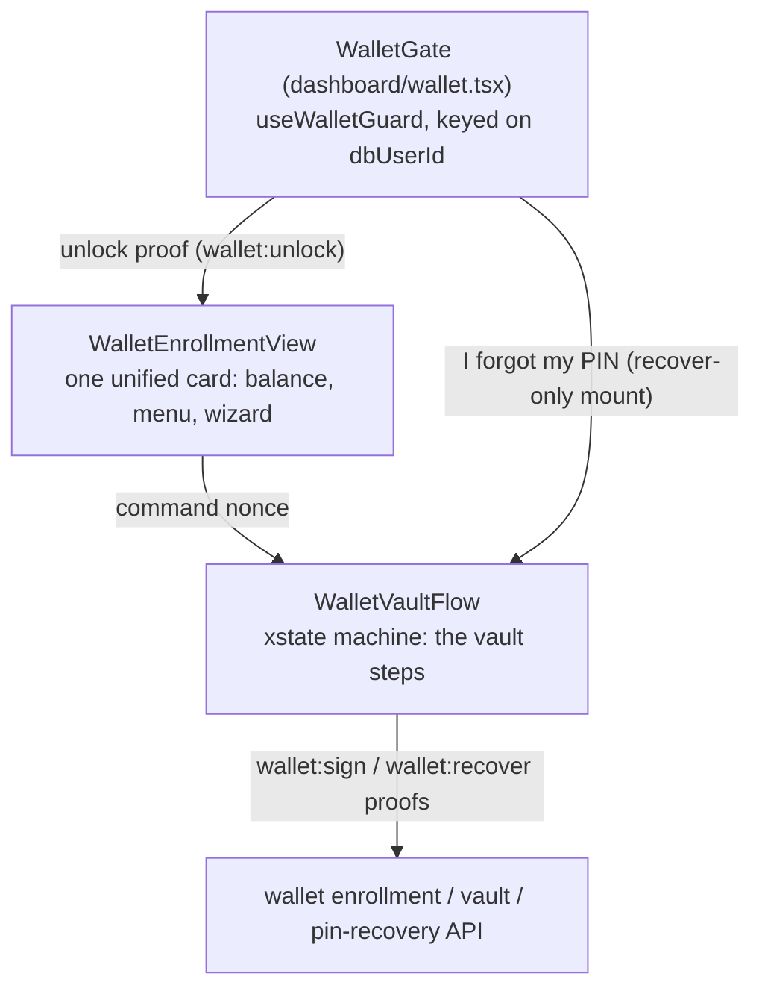
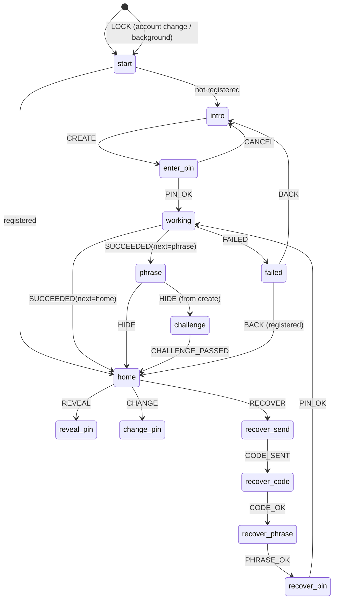

# Wallet onboarding: gate, vault wizard, PIN and security (mobile)

The non-custodial wallet's client surface: how a person gets from "signed in" to "wallet
created", what asks for the PIN and why, what happens on a PIN change whose outcome is
unknown, and how a locked-out person gets back in. The second-factor protocol itself
(verifiers, proofs, lockout, the recovery endpoint contract) is documented in
[SECOND_FACTOR_PIN.md](../../auth/SECOND_FACTOR_PIN.md); this page is the app-side flow.

Everything below is gated to the dev/testnet environment (`setupEnabled` and
`scope.environment === 'development'`) — people on other builds see an honest
"not available in this build" card, never a silent absence.

## 1. The layers

- **The gate** (`app/(shared)/dashboard/wallet.tsx`)
  owns the whole screen until the wallet is unlocked. Nobody — tabs, balance, the card —
  renders before it passes.
- **The card** (`WalletEnrollmentView`) is the wallet's home once unlocked: one card with
  the balance, send/receive, and a menu whose entries (export phrase, change PIN, I forgot
  my PIN) issue a `VaultCommand` (type + nonce) into `WalletVaultFlow`.
- **The flow** (`WalletVaultFlow`) is the only place the vault's steps exist: create,
  reveal, change, recover. One xstate machine, one actor per wallet identity.

## 2. The gate and the proof-owner identity

`useWalletGuard` walks `checking → pin_setup | pin_entry | locked | unlocked | unavailable`
and re-checks on every mount: a proof is in-memory only, so closing the app or switching
accounts drops it and the gate must follow.

**The guard, the enrollment row and the vault flow must all key on `dbUserId`** (the
registry Supabase uuid from `useAuth()`), never `user.id` (the auth provider's own id —
see [`db-user-id-pattern.md`](db-user-id-pattern.md)). Proofs are stored per owner in
`lib/step-up-session.ts`, and `rememberProof` drops *every* proof the moment the owner
changes. If the gate were keyed on the provider id while the enrollment row uses the
registry id, a proof stored during the wizard would clear the gate's proof mid-flow — a
person would be asked for the PIN again or bounced out entirely. The wallet screen
therefore passes `dbUserId` (and holds the gate at `checking` while auth is still loading).

| Gate phase | What the person sees |
|------------|----------------------|
| `checking` | "Checking your wallet protection…" |
| `pin_setup` (no PIN yet) | PIN creation, with the honest one-PIN warning |
| `pin_entry` / `locked` | PIN entry + **"I forgot my PIN"** (below) |
| `unavailable` | Error + retry, never a silent blank |
| `unlocked` | The wallet content (tabs, card) |

## 3. Onboarding: create-only vault wizard

`WalletVaultFlow` runs the machine defined in
[`hooks/wallet-vault-machine.ts`](../../../../apps/mobile-app/hooks/wallet-vault-machine.ts):

Rules the machine encodes:

- **Create-only.** HASHPASS manages wallets it generates itself. There is no import path in
  the UI (and the intro says so); the phrase can be *exported* at any time.
- **The phrase is shown once, on the full-screen secure modal.** PIN-entry steps render
  inline inside the card — a PIN pad is a question, not a secret — while every screen that
  actually carries secret material (phrase, challenge, recovery phrase/code, backup) takes
  over the full screen with the modal, and `lockNow` (on background/account change) clears
  all transient secret state before the machine resets to a non-secret step.
- **The challenge** asks for specific words of the saved phrase before the wallet counts as
  fully set up (create path only).

### Why the PIN is asked twice at creation

This is two different jobs, not one repeated question:

1. **The gate** verifies *identity*: it takes the existing PIN (or walks first-time creation
   with a create+confirm double entry) and exchanges it for a short-lived `wallet:unlock`
   proof. This is the same "re-enter before something sensitive" step as everywhere else.
2. **The wizard's `enter_pin`** needs the *digits themselves*, because the PIN is a
   cryptographic input: the vault envelope is wrapped with a key derived from the PIN
   (plus a server share), and re-wrapping on a PIN change needs the same. The app never
   stores the PIN anywhere — the digits live in the pad's transient state for the length of
   one call — so it has to ask for them when it needs to encrypt with them.

Creation then uses a `wallet:sign` proof (60 s) for the reservation/creation call, and the
vault envelope is saved with `expectedVersion: 0` under a `wallet:unlock` proof.

## 4. Changing the PIN: rewrap first, swap the verifier second, and what "unknown" means

`HybridWallet.changePin` (`packages/wallet/src/hybrid-wallet.ts`) is deliberately ordered:

1. The vault envelope is re-wrapped under the *new* PIN and saved **before** the server
   verifier swap.
2. Then the verifier is swapped via `changeServerPin`, whose contract distinguishes three
   outcomes: resolved `true` (replaced), resolved `false` (server authoritatively said no —
   wrong current PIN, lockout), or **thrown** (transport failed — the outcome is unknown:
   the server may have committed).

- **Authoritative rejection** → the envelope is restored to the old PIN (rewrap
  new→current, save with the next version) and the flow fails with a normal "did not work".
- **Unknown outcome** → the envelope is **left on the new PIN** and the flow fails with
  `wallet_pin_change_unknown`. Rolling back blindly here could strand the pair (server
  verifier new, envelope old) with no way back; keeping the vault on the new PIN means the
  person's next move is simply to unlock with the new PIN. If the server did *not* commit,
  the same email-code recovery path as a forgotten PIN rebuilds the vault — that is the net.

`usePin` exposes this tri-state as `setPinDetailed(): 'changed' | 'rejected' | 'unknown'`
(`setPin` remains the boolean convenience for flows that don't care). Only `'rejected'` may
be treated as an authoritative "nothing happened".

## 5. "I forgot my PIN" — from the locked gate and from the wallet

Recovery (email code + recovery phrase; the full contract is
[SECOND_FACTOR_PIN.md §12](../../auth/SECOND_FACTOR_PIN.md#12-wallet-pin-recovery-email-code--recovery-phrase))
is reachable from two places:

1. **Inside the wallet** (the card's menu → `RECOVER` command) — for someone who can
   unlock but wants a new PIN.
2. **From the locked gate**, *before* any unlock — for someone who never knew the PIN or
   forgot it. The gate loads the enrollment row first:
   - `state: 'registered'` → mounts `WalletVaultFlow` with `recoverOnly`: the machine jumps
     straight into `recover_send` and **the wallet's home is never rendered** — no balance,
     no actions, nothing protected is exposed to a person who has not unlocked.
   - no wallet on the account → an honest "nothing to recover" message (the PIN still
     protects the account itself; that is a sign-in problem, not a wallet one).
   - load failure → "could not reach the recovery service" + back to PIN entry, never a
     dead end.

The CANCEL paths from any recovery step return to where the flow was entered (the wallet's
home, or the gate's PIN entry via `onExit`).

## 6. Security properties to keep when changing this code

| Property | Where it is enforced |
|----------|---------------------|
| The PIN is never stored client-side; digits live in the pad for one call | `PinPad`/`PinFlow` + `usePin` |
| Proofs are in memory only, per-owner, dropped on expiry/account change/sign-out | `lib/step-up-session.ts` |
| Gate, enrollment and vault key on the registry id (`dbUserId`), never `user.id` | `app/(shared)/dashboard/wallet.tsx` |
| Vault envelope is wrapped under the PIN; server never re-wraps on its own | `packages/wallet/src/hybrid-wallet.ts`, `lib/wallet/hybrid-vault-api.ts` |
| Unknown-outcome PIN change keeps the vault on the new PIN and says so | `changePin` + `wallet_pin_change_unknown` |
| Recover-only mount never shows wallet home or any protected surface | `WalletVaultFlow` `recoverOnly` |
| Phrase/backup screens take the full screen; LOCK clears transient secret state | `WalletVaultFlow` inline/secure split, `lockNow` |
| No wallet import: create-only; export always available | machine has no import step |
| Help drawer honors app and system reduced-motion preferences | `components/ui/DrawerSheet.tsx` |

## 7. Files and tests

| File | Role |
|------|------|
| `app/(shared)/dashboard/wallet.tsx` | Gate + recovery entry + wallet content |
| `components/wallet/WalletEnrollmentView.tsx` | The unified card; menu → `VaultCommand` |
| `components/wallet/WalletVaultFlow.tsx` | The vault wizard (all steps, recover-only mode) |
| `components/wallet/WalletHelpDrawer.tsx` | In-app security FAQ (drawer) |
| `hooks/wallet-vault-machine.ts` (+ `.types.ts`) | The xstate machine and event union |
| `hooks/useWalletGuard.ts` (+ `wallet-guard-machine.ts`) | The gate |
| `hooks/usePin.ts`, `types/pin.types.ts` | PIN transport, tri-state `setPinDetailed` |
| `lib/wallet/*` | enrollment, vault transport, recovery, lifecycle, device wallet |
| `packages/wallet/src/hybrid-wallet.ts` | Envelope rewrap, `changePin` ordering |

Tests to keep green when touching this area: `tests/wallet` (screen gate, enrollment view,
help drawer, vault flow), `tests/components/security` (PinFlow, PinPad, SetupWizard),
`tests/hooks/usePin.test.tsx`, and the package suite `packages/wallet` (`npm test` there —
node:test, not vitest). PR coverage requires ≥ 69% of new/changed lines.
