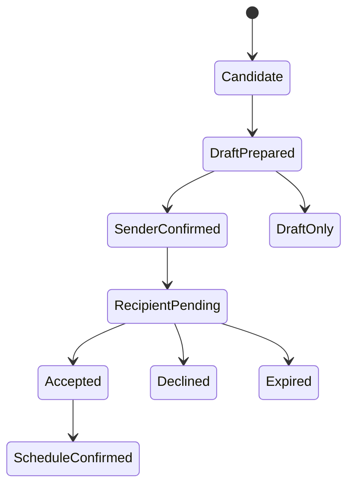

# HASHPASS Companion — Agenda Intelligence & consented networking (ADR-HMC-002)
**Date:** 2026-10-26 | **Status:** P1 proposed, not shipped. **Owners:** HASHPASS product / networking policy. **Engineering:** [#464](https://github.com/hashpass-tech/hashpass.tech/issues/464), [#465](https://github.com/hashpass-tech/hashpass.tech/issues/465).

## User value
Companion improves conference attendance: "Which BSL sessions should I go to, which speakers are most relevant to my goals, and how can I respectfully request a meeting with people who opted into networking?"

## Agenda ranking: typed and evidence-based
**Inputs:** organizer-authorized BSL schedule with speaker bios and source timestamps; user-declared topics, sector interests, professional goals, language and accessibility needs, explicit availability. Optional contact-network context only if user has separately authorized a suitable provider/integration and its permitted data access.

**Candidate generation:** event session list -> schema and source validity -> attendee's event/timezone -> remove conflicting/impossible sessions -> topic matching -> personalized ranking and transparent explanation -> proposed save-to-agenda (explicit approval).

### Score design (illustrative; tune on feedback, not a measured ranking)
`score = 0.35*explicit_topic_match + 0.25*goal_fit + 0.20*relevant_speaker_expertise + 0.10*novelty + 0.10*schedule_fit`
Use only observable/authorized professional information; no sensitive trait profiling. Hard filter schedules with impossible overlaps rather than hiding them under a weighted score. Show uncertainty, missing availability and rationale. The speaker's attendance/scheduling must be grounded in official program data, not model imagination.

**Example:** "Recommend two talks about stablecoin payments and onchain identity that don't overlap, then add the first to my agenda." Output: two source-linked sessions; proposed save; confirmed, idempotent action.

## Professional networking and meeting flow
A conference listing is **not** consent to direct outreach. A person is requestable only if discoverable in authorized event networking directory and opts into invitations (or a user chooses to create a draft to use elsewhere).



- Search relevant attendee/speaker profiles within explicit, current permissions and organizer terms.
- Show match explanation and shared professional subject *without inventing existing personal relationship, prior meetings or social-graph edges*.
- Draft a short personalized request (EN/ES) with user intent, proposed slots, scope of profile disclosure.
- Allow user edit. Explicit confirmation creates an outbound request *only if an authorized channel exists*.
- Recipient must independently accept/decline. Create calendar booking only when both parties consent and slot confirmed.
- Without actual outbound integration or recipient opt-in, return **draft only**, never "sent".
- Honor opt-out, user blocks, rate limits, abuse reports, request expiration, delete rights and audit logs. Never scrape LinkedIn contacts/social graph without explicit authorization and allowed integration.

## Data contracts (design only)
```text
Session(id,eventId,title,startAt,endAt,timezone,room,speakerIds,topics,sourceId,updatedAt)
Speaker(id,name,role,bio,topics,sourceId,publicListing,networkingOptIn)
UserPreferences(userId,topics,goals,excludedTopics,preferredLanguages,consentUpdatedAt)
NetworkingConsent(userId,eventId,discoverableFields,allowRequests,expiresAt,withdrawnAt)
MeetingRequest(id,eventId,senderId,recipientId,status,message,proposedSlots,consentedAt,acceptedAt,idempotencyKey)
```

Tool signatures (typed + authorized): `get_conference_agenda`, `recommend_sessions`, `recommend_speakers`, `propose_add_to_agenda`, `confirm_add_to_agenda`, `find_networking_matches`, `draft_intro`, `propose_meeting_request`, `confirm_meeting_request`, `get_meeting_request_status`, `respond_to_meeting_request`.

## Minimum P1 QA
- Twelve source-grounded session fixtures; six speaker profiles; five varied preference personas; conflict/timezone logic.
- At least 5 sample queries EN/ES with rationale and exact source references, no invented conference facts.
- Candidate permission tests: opted-out invisible, revoked consent enforced, private fields never surfaced.
- Outbound safety: no request without confirmed sender action; no calendar meeting without recipient acceptance.
- Duplicate/idempotency, expired invites, race conditions, spam/rate limits, denied permissions, withdrawal.
- Observe real participation quality rather than vanity recommendation score: saved sessions, conflict corrections, accepted *opted-in* meeting requests, user satisfaction.

## Delivery plan and guardrails
P0 real voice/text agent plus DoorReady due **Fri Oct 30 17:30 COT**; these P1 skills cannot jeopardize that gate. First networking demo may use explicitly synthetic *two-user* flows if organizer lacks directory/invite API, prominently labeled prototype. Production integrations require separate approvals.

## Differentiation
A ticket wallet says **where you go**. A source-grounded event companion explains **why to go**, **who might be worth meeting** and **how to request a meeting respectfully**. This is a potential commercial network effect, not a claim of live social graph access.
