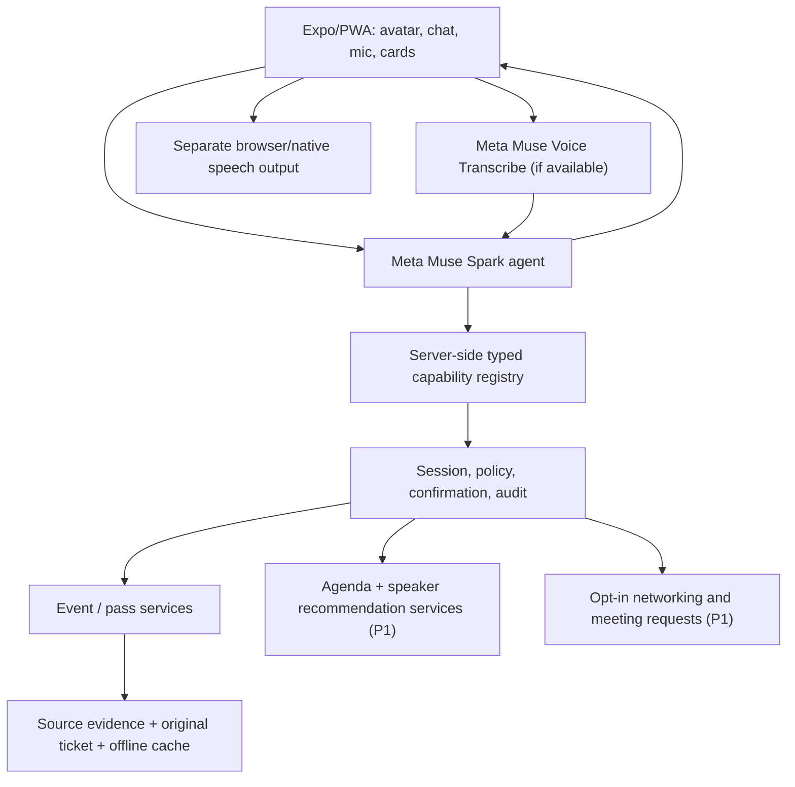

# HASHPASS Muse Companion — Architecture and product scope (ADR-HMC-001)
**Date:** 2026-10-26 | **Status:** Proposed for implementation; P0 work tracked in [#455](https://github.com/hashpass-tech/hashpass.tech/issues/455). **Owner:** @edcalderon.

## Product statement
HASHPASS Companion is a Meta Muse-powered, expressive, app-wide event companion. It helps people understand their event commitments, navigate their existing digital passes, discover relevant sessions and people, and make permitted actions using typed voice/text commands. **DoorReady** is the first domain skill (ticket import, cross-source update reconciliation, preserved original ticket and offline Door Mode), not the full product.

**Vision:** "A personal agent for everything happening around you at events: what to attend, who to meet, and how to get in."

## Core vs expansion
**P0 — by Fri Oct 30 17:30 America/Bogota:** Real Meta Muse Spark 1.3 tool-call pipeline, secure user-scoped read, allowlisted navigation, user-confirmed write, Muse Voice Transcribe 1.0 STT where verified, text fallback, readable/talking companion shell (separate TTS), and DoorReady's original QR offline. **No fabricated data, automatic admission validity claim or unrestricted agent control.**

**P1 — after P0:** [Speaker/session agenda intelligence #464](https://github.com/hashpass-tech/hashpass.tech/issues/464) and [Opt-in attendee networking/meeting request #465](https://github.com/hashpass-tech/hashpass.tech/issues/465). If these features are demoed before P0 freeze, use approved or synthetic data and label them accurately as preview rather than live networking availability.

**P2 — post-hackathon:** durable opt-in preference memory with deletion, event/social graph with authorized permissions, verified two-sided meeting calendar integration, speaker office hours/availability, broader HASHPASS action registry, optional ESP32-S3 physical avatar.

## Component architecture

## Capability boundary
An LLM selects or proposes *typed* app functions and structured arguments. It does not control the browser DOM, bypass backend authorization, call arbitrary URLs, send invitations unconfirmed, mutate tickets, or access private profiles outside consent. All writes use user-visible action proposal and confirmation. High-impact functions (money, wallets, ticket transfer, account deletion, organizer changes) excluded.

## Three P0 proof interactions
1. **Read:** "What is my next event?" -> authenticated user-scoped answer from existing app data.
2. **Navigate:** "Open my ticket." -> allowlisted route for source ticket / agenda, not guessed deep-link.
3. **Confirmed write:** "Import this schedule change." -> review evidence, user approves, backend stores update with audit.
Offline original admission ticket remains unchanged and available after sync.

## Model and voice
- Meta Muse Spark 1.3 through the documented Model API for reasoning, extraction and tool calling; test actual entitlement first.
- Meta Muse Voice Transcribe 1.0 for voice-to-text where supported; handle user permission and language errors. **Transcribe is not speech synthesis.**
- Use separately approved TTS, or local browser speech output with text fallback. Never state spoken output is from Meta ASR.
- Meta free-credit interface shows $150 active; screenshot warns free-credit processed content may be used for product improvement. Use synthetic/authorized samples until processing rights verified, never expose credentials.
- Baseten/Modal/Fireworks are optional, credit eligibility unverified and never required in core processing.

## Domain boundaries
Use existing HASHPASS Expo Router and shared types/backend/design system. Respect CLAUDE.md, AGENTS.md, DESIGN.md. Prefer existing event/agenda/ticket services after audit; do not pretend endpoints exist. Never destabilize production check-in or alter protected release workflow.

## Non-functional acceptance
Authorization on every tool, idempotent/confirmed writes, per-user data isolation, provenance-backed recommendations, graceful offline and missing permission handling, EN/ES dialogue, accessible 360px responsive UI, error/latency/cost reporting, user consent with withdrawal, original ticket hash integrity, 20 synthetic/authorized tests, actual live model responses.

## Open questions
- Logged-in Cerebral Valley official rules: reuse existing repo permissible? Public materials do not establish requirement for new repo.
- Muse ASR endpoint entitlement/pricing and eligible languages/real-time setup.
- Actual agenda and speaker data coverage at BSL; organizer permission and freshness.
- Attendee directory consent/outbound meeting-request capability.
- Production-use conditions of promotional Model API credit.

**Engineering and chronological work:** [#455](https://github.com/hashpass-tech/hashpass.tech/issues/455) and [#457–#462](https://github.com/hashpass-tech/hashpass.tech/issues/457). Plane should eventually archive this ADR with links back to source GitHub; GitHub remains the single tracker.
